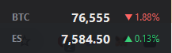

# Desktop Ticker

A tiny always-on-top Windows widget that shows the live **Bitcoin** price and the **S&P 500**:
**SPY** during regular market hours, **ES futures** after hours, overnight and on weekends.



## Install (Windows 10 / 11)

1. **[Click here to download DesktopTicker.exe](https://github.com/DDP5286/desktop-ticker/releases/latest/download/DesktopTicker.exe)**
2. Open your **Downloads** folder and double-click **DesktopTicker.exe**.
3. If a blue **"Windows protected your PC"** box appears, click **More info**, then **Run anyway**.
   (This shows for any new app that isn't from a big company. It only happens the first time.)

The widget appears in the bottom-right corner of your screen, just above the taskbar. That's it.

**Tip:** move `DesktopTicker.exe` somewhere permanent (for example your **Documents** folder) *before* you turn on
*Start with Windows*, so it doesn't get lost when you clean out Downloads.

## Using it

- **Move it:** click and drag it anywhere. It remembers where you leave it.
- **Right-click it** for options:
  - **Always on top**: keep it above other windows
  - **Start with Windows**: open it automatically every time you turn on your PC
  - **Reset position**: put it back in the bottom-right corner
  - **Exit**: close it

## Uninstall

1. Right-click the widget, untick **Start with Windows**, then click **Exit**.
2. Delete `DesktopTicker.exe`.

## What it shows

- **BTC:** live price, updated every 2 seconds, with the change over the last 24 hours
- **SPY** (market hours) or **ES** (S&P 500 futures, all other times): updated every 5 seconds, with the change from
  the previous close. It switches automatically and knows about market holidays and early closes.

## Data sources

- **BTC:** [Coinbase Exchange public API](https://docs.cdp.coinbase.com/exchange/)
- **SPY and ES futures:** Yahoo Finance's public chart endpoint. It's unofficial and undocumented, so it may change or
  stop working without notice.

Prices are for personal, informational use only. They may be delayed or wrong, so don't trade on them.

## For developers

The whole app is one Python file, `ticker.pyw`, using only the standard library (Python 3.9+ with tkinter).

Run from source:

```
git clone https://github.com/DDP5286/desktop-ticker.git
cd desktop-ticker
pythonw ticker.pyw
```

Build the `.exe`:

```
python -m pip install pyinstaller
python -m PyInstaller --onefile --windowed --name DesktopTicker --icon assets/icon.ico ticker.pyw
```

The result is in `dist/DesktopTicker.exe`. Settings are saved in `%APPDATA%\desktop-ticker.json`.

## License

[MIT](LICENSE)
